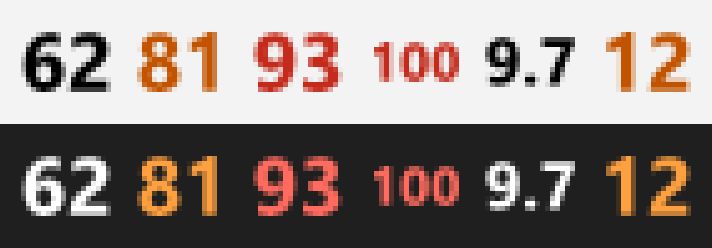

# MemIndicator

Mostra o uso de memória RAM em tempo real direto no ícone da bandeja do Windows, ao lado do relógio.



*Ampliado 5×. Da esquerda para a direita: uso normal, alerta (75%+), crítico (90%+), 100%, e o modo GB abaixo e acima de 10 GB.*

## Recursos

- **Valor no próprio ícone**, atualizado a cada segundo. Não precisa passar o mouse para ver.
- **Dois modos**, alternáveis pelo menu do botão direito. O modo escolhido fica salvo para a próxima vez.
  - **Porcentagem** (padrão): o mesmo valor de "Em uso" do Gerenciador de Tarefas.
  - **GB usados**: mostra uma casa decimal abaixo de 10 GB (`9.7`) e número inteiro a partir daí (`12`).
- **Cores por faixa de uso**:
  - Até 74%: texto preto, ou branco se a barra de tarefas estiver no tema escuro. Acompanha a troca de tema automaticamente.
  - De 75% a 89%: laranja.
  - A partir de 90%: vermelho.
- **Tooltip** com os detalhes, ex.: `Memória: 62% — 9.7 / 15.7 GB`.
- **Clique esquerdo** abre o Gerenciador de Tarefas.
- **Inicia com o Windows**, com opção para desligar no menu.
- **Fixa-se sozinho ao lado do relógio** no Windows 11, em vez de ir para o menu oculto (`^`).
- **Leve**: cerca de 15 MB de memória privada e uso de CPU desprezível.

## Requisitos

- Windows 11. No Windows 10 deve funcionar, mas não foi testado, e o ícone não se fixa sozinho ao lado do relógio.
- Para rodar: [.NET 8 Desktop Runtime](https://dotnet.microsoft.com/download/dotnet/8.0).
- Para compilar: [.NET 8 SDK](https://dotnet.microsoft.com/download/dotnet/8.0), que já inclui o runtime.

## Instalação

```powershell
git clone https://github.com/brenoacp/memindicator.git
cd memindicator
powershell -ExecutionPolicy Bypass -File .\install.ps1
```

O script:

1. compila o app (`dotnet publish`);
2. fecha a cópia que estiver rodando, se houver;
3. copia o executável para `%LOCALAPPDATA%\MemIndicator\MemIndicator.exe`;
4. inicia o app.

Não precisa de permissão de administrador. Para atualizar, rode o mesmo comando de novo.

## Uso

Clique com o botão direito no ícone para abrir o menu:

| Opção | O que faz |
| --- | --- |
| Mostrar porcentagem (%) | Exibe o percentual de RAM em uso |
| Mostrar GB usados | Exibe os GB de RAM em uso |
| Iniciar com o Windows | Liga ou desliga a inicialização automática |
| Sair | Fecha o app |

## Onde ficam as configurações

Tudo fica no registro do usuário atual (`HKCU`):

| Chave | Valor | Conteúdo |
| --- | --- | --- |
| `HKCU\Software\MemIndicator` | `DisplayMode` | `Percent` ou `Gigabytes` |
| `HKCU\Software\MemIndicator` | `AutoStartInitialized` | Indica que o autostart padrão já foi aplicado, para que desligá-lo no menu seja respeitado |
| `HKCU\Software\Microsoft\Windows\CurrentVersion\Run` | `MemIndicator` | Caminho do executável, se "Iniciar com o Windows" estiver ligado |

## Desinstalação

Feche o app pelo menu (**Sair**) e rode:

```powershell
Remove-ItemProperty 'HKCU:\Software\Microsoft\Windows\CurrentVersion\Run' -Name MemIndicator -ErrorAction SilentlyContinue
Remove-Item 'HKCU:\Software\MemIndicator' -Recurse -ErrorAction SilentlyContinue
Remove-Item "$env:LOCALAPPDATA\MemIndicator" -Recurse -ErrorAction SilentlyContinue
```

## Desenvolvimento

```powershell
dotnet build
dotnet test
```

Para rodar a versão de desenvolvimento sem instalar:

```powershell
dotnet run --project src\MemIndicator
```

> **Atenção:**
> - Só uma instância roda por vez. Feche a versão instalada antes de rodar a de desenvolvimento.
> - Se "Iniciar com o Windows" estiver ligado, a inicialização automática passa a apontar para o executável que estiver rodando. Depois de testar, rode `install.ps1` de novo para que ela volte a apontar para a versão instalada.

### Estrutura

```
src/MemIndicator/
  Program.cs            Ponto de entrada; garante uma única instância
  TrayApplication.cs    Ícone da bandeja, menu, timers e saída limpa
  DisplayFormatter.cs   Texto do ícone, tooltip, faixas e cores (lógica pura)
  IconRenderer.cs       Desenha o número no bitmap do ícone
  MemoryReader.cs       Lê a memória via GlobalMemoryStatusEx
  TrayPromoter.cs       Fixa o ícone ao lado do relógio (Windows 11)
  AutoStart.cs          Entrada em HKCU\...\Run
  AppSettings.cs        Configurações em HKCU\Software\MemIndicator
tests/MemIndicator.Tests/
  Testes xUnit do formatador, do renderizador e do TrayPromoter
install.ps1             Publica e instala em %LOCALAPPDATA%\MemIndicator
```

## Como funciona

- **Leitura da memória.** A cada segundo o app chama `GlobalMemoryStatusEx`. O percentual vem de `dwMemoryLoad`, o mesmo número que o Gerenciador de Tarefas mostra. Os GB são calculados como total menos disponível, em GiB (1024³), também como no Gerenciador.
- **Desenho do ícone.** O número é desenhado como path vetorial, em Segoe UI Bold, no tamanho de ícone pequeno do sistema (20×20 px com escala de 125%). O tamanho da fonte é calculado para o conjunto de todos os dígitos possíveis. Assim, `11` e `88` ficam do mesmo tamanho, e nenhum dígito é cortado na borda.
- **Quando o ícone é recriado.** Só quando o texto, a cor ou o tamanho mudam. Os handles antigos são liberados com `DestroyIcon`, para não vazar recursos GDI.
- **Fixação ao lado do relógio.** O Windows 11 registra cada ícone da bandeja em `HKCU\Control Panel\NotifyIconSettings`. O app procura a própria entrada e grava `IsPromoted = 1`. Como o Explorer só cria essa entrada alguns segundos depois de o ícone aparecer, o app tenta a cada 2 s, por até 30 s. Isso acontece toda vez que o app abre: se você mover o ícone para o menu oculto, ele volta para o lado do relógio na próxima inicialização.
- **Atualização sem ícone fantasma.** O `install.ps1` sinaliza o evento nomeado `Local\MemIndicator-Exit`, e a cópia em execução fecha sozinha, removendo o ícone da bandeja. Só se ela não responder em 5 s o processo é encerrado à força.
